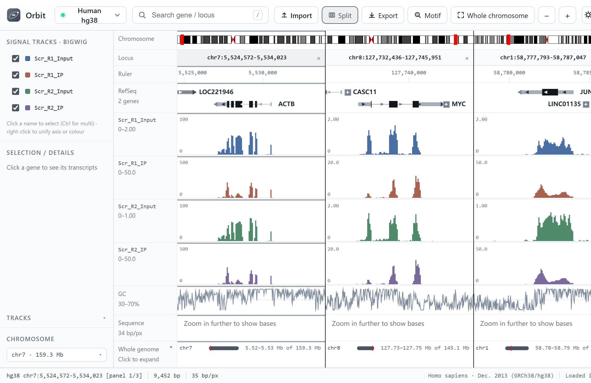

# Orbit

[](https://orbit-genome-browser.readthedocs.io/en/latest/)
[](https://github.com/junjunlab/Orbit/releases)
[](LICENSE)

A fast, offline-first **desktop genome browser** — a lightweight alternative to IGV Desktop.
Native window, double-click to run, no Java, no server setup.

RefSeq annotations are compiled into a binary index at build time, while sequence is
fetched on demand from UCSC 2bit files over HTTP Range requests. That is why the installer
ships ~70 MB of annotation instead of 3 GB of genome.



## Documentation

The full manual is available in both languages:

- **[English](https://orbit-genome-browser.readthedocs.io/en/latest/)**
- **[简体中文](https://orbit-genome-browser.readthedocs.io/zh-cn/latest/)**

Both are built from `docs/` with Sphinx. Use the language flyout at the bottom-left of
any page to switch between them.

## Install

Download the package for your platform from [Releases](https://github.com/junjunlab/Orbit/releases):

| Platform | File | Size |
|---|---|---|
| Windows 10/11 x64 | `Orbit-1.0.0-Windows-x64-Setup.exe` | ~150 MB |
| macOS Apple Silicon | `Orbit-1.0.0-macOS-arm64.dmg` | ~235 MB |
| macOS Intel | `Orbit-1.0.0-macOS-x86_64.dmg` | ~253 MB |

- **Windows** — per-user install, no admin rights needed (`%LOCALAPPDATA%\Programs\Orbit`).
- **macOS** — drag `Orbit.app` into Applications. Builds are ad-hoc signed, not notarized,
  so the first launch needs **right-click → Open**. If macOS says the app is damaged, run
  `xattr -dr com.apple.quarantine /Applications/Orbit.app`.

## Features

- Gene tracks from RefSeq with transcript expansion (exon/intron, CDS, strand)
- Cytobands, GC content, and sequence track (colored bases at high zoom)
- Signal tracks: bigWig, bedGraph — multi-sample overlays with grouped scaling
- Import your own bigWig / bedGraph / BAM / GTF / FASTA at runtime
- Split view for comparing several loci side by side
- Deep links (`?db=hg38&locus=chr17:7,658,827-7,697,125`) for sharing a view
- Export the current view to PNG, SVG, or PDF
- Chinese and English interface, switched from the toolbar and remembered across launches
- Dark mode, session persistence, keyboard navigation

## Built-in assemblies

Nine species, two releases each. Annotation is bundled; sequence is streamed from UCSC.

| Species | Current | Previous |
|---|---|---|
| Human | `hg38` | `hg19` |
| Mouse | `mm39` | `mm10` |
| Rat | `rn7` | `rn6` |
| Zebrafish | `danRer11` | `danRer10` |
| Fly | `dm6` | `dm3` |
| Worm | `ce11` | `ce10` |
| Yeast | `sacCer3` | `sacCer2` |
| Frog | `xenTro10` | `xenTro9` |
| Chicken | `galGal6` | `galGal5` |

The first visit to a chromosome takes about a second (range request), then ~0.3 s.
Set `ORBIT_OFFLINE=1` to force local 2bit files only.

## Run from source

```bash
pip install -r requirements.txt
python -m igvlocal                # native Qt window
python -m igvlocal --browser      # fall back to the system browser
```

## Build

```bash
python build/make_exe.py --no-genomes --windowed   # freeze (no 2bit → ~70 MB)
ISCC.exe installer\orbit.iss                       # Windows installer
bash installer/make_dmg.sh                         # macOS → .dmg
```

CI (`.github/workflows/build.yml`) builds all three packages on every tag push and
attaches them to the release.

## Building the documentation

The manual lives in `docs/` (Sphinx + reStructuredText, hosted on Read the Docs).
English is the source language; Chinese is a gettext translation.

```bash
pip install -r docs/requirements.txt
sphinx-build -b html docs docs/_build/html               # English
sphinx-build -b html -D language=zh_CN docs docs/_build/html-zh
```

## How it works

- **Sequence** — reads UCSC `.2bit` directly, locally or over HTTP Range.
- **Annotation** — a custom `.igvbin` index built once from RefSeq `refGene`, so a whole
  chromosome's genes load in milliseconds instead of parsing GTF at startup.
- **Signal** — parses `bigWig` itself, no external tools.
- **Backend** — pure Python standard library. **Frontend** — vanilla JS and Canvas, no framework.

## License

MIT
