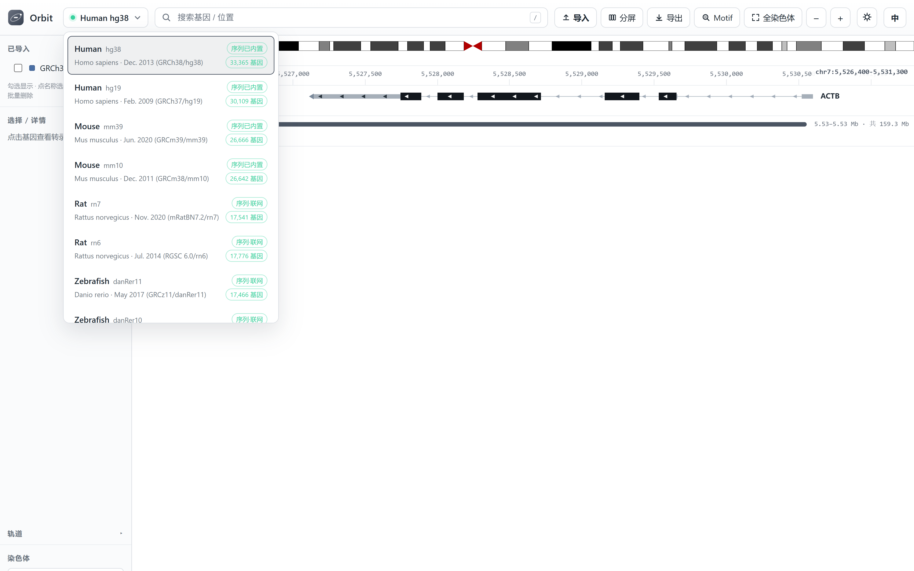
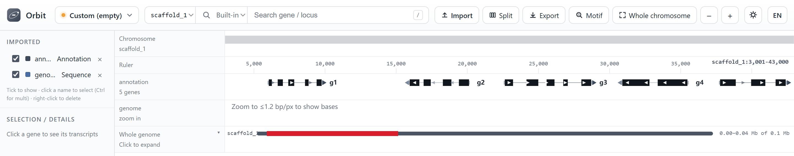
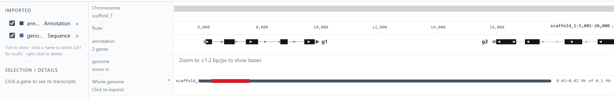
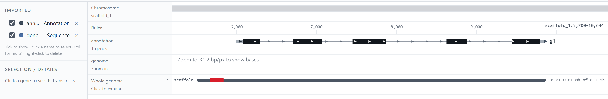
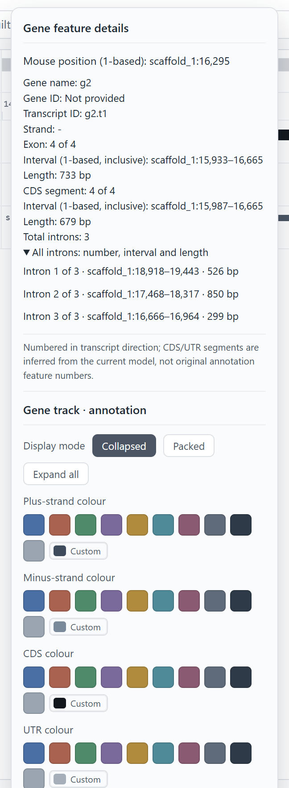
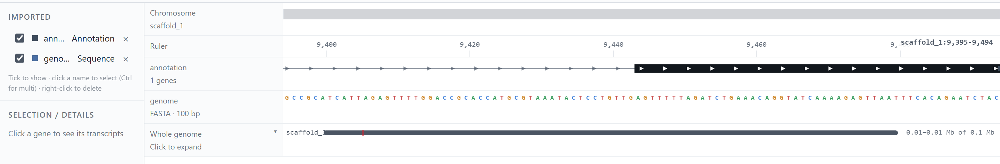

Assemblies
==========

Orbit bundles annotation for 18 assemblies across 9 species. Sequence is not
bundled — it is streamed from UCSC on demand, which is what keeps the download
small.

Bundled assemblies
------------------

   Choose the reference build before searching or importing. The bundled
   annotation list is not a claim that these are the newest available assemblies.

.. list-table::
   :header-rows: 1
   :widths: 30 20 20 30

   * - Species
     - Bundled newer build
     - Bundled older build
     - Source
   * - Human
     - ``hg38``
     - ``hg19``
     - UCSC refGene
   * - Mouse
     - ``mm39``
     - ``mm10``
     - UCSC refGene
   * - Rat
     - ``rn7``
     - ``rn6``
     - UCSC refGene
   * - Zebrafish
     - ``danRer11``
     - ``danRer10``
     - UCSC refGene
   * - Fly
     - ``dm6``
     - ``dm3``
     - UCSC refGene
   * - Worm
     - ``ce11``
     - ``ce10``
     - UCSC refGene
   * - Yeast
     - ``sacCer3``
     - ``sacCer2``
     - UCSC ncbiRefSeq / sgdGene
   * - Frog
     - ``xenTro10``
     - ``xenTro9``
     - UCSC refGene
   * - Chicken
     - ``galGal6``
     - ``galGal5``
     - UCSC refGene

Each assembly carries gene models, cytobands, chromosome sizes and the primary
chromosome order used by the overview panel.

How sequence is fetched
-----------------------

Every assembly in ``data/catalog.json`` records a ``twoBitURL`` pointing at the
UCSC 2bit file. When you navigate, Orbit issues an HTTP Range request for just
the bytes covering the window and decodes them locally.

* Response time depends on the network and reference index.
* The range cache is in memory and per session, not a persistent offline genome.
* Local 2bit takes priority over the remote source.

If the network is unavailable, the sequence and GC tracks go grey and
everything else keeps working.

Offline mode
------------

Set ``ORBIT_OFFLINE=1`` before launching to disable remote 2bit fallback.
A local matching 2bit supplies built-in reference operations offline. Imported
FASTA remains an independent sequence track; see :doc:`sequence`::

   set ORBIT_OFFLINE=1
   Orbit.exe

With no local sequence the GC and sequence tracks stay disabled, but genes,
cytobands, search and imported tracks are unaffected.

Working with a non-model organism
---------------------------------

You do not need a catalog entry to look at your own assembly. Pick the empty
**Custom** assembly, import the genome FASTA, then import the annotation. Orbit
builds the chromosome axis from the files themselves, so a newly assembled
genome with names like ``scaffold_1`` works the same way a reference build does.

.. code-block:: text

   1. Assembly menu → 自定义（空 · 用自己导入的 FASTA / GTF）
   2. Import → genome.fa
   3. Import → annotation.gff3
   4. Tick both tracks in the sidebar

Order matters only in that the FASTA has to arrive before anything that needs a
coordinate axis; the gene track draws itself as soon as the annotation is parsed.

   A three-scaffold assembly (``scaffold_1``, 150 kb) with its own GFF3. The
   annotation track reports *5 genes* over a 40 kb window; the FASTA track below
   it holds the sequence and switches to bases once you zoom past 1.2 bp/px. The
   bundled RefSeq, GC and ideogram rows are hidden because a custom assembly has
   no cytobands and no bundled annotation for them to draw.

Both strands, exons and introns come from the file, not from any assumption
about the organism:

   Collapsed view: gene models packed onto one row, exon boxes and intron lines
   drawn from the GFF3. ``g1`` runs 5'→3' to the right, ``g2`` to the left.

   The same track with one gene expanded. Each transcript gets its own row, with
   CDS blocks darker than UTR and the introns drawn as connecting lines.

Right-clicking a model opens the same detail popover used for RefSeq, fed by the
imported GFF3:

   Exon 4 of 4 on the minus strand, its interval and length, the matching CDS
   fragment, and all three introns with coordinates. Gene IDs read *not
   provided* because this GFF3 carries no ``ID=`` beyond the transcript name.

   Base level from the imported FASTA: coloured nucleotides inside the exon,
   with the intron line ending at the exon boundary above.

Things worth knowing
~~~~~~~~~~~~~~~~~~~~

* **Sequence names must match between the two files.** ``chr1`` and ``1`` are
  treated as the same chromosome, but ``scaffold_1`` and ``Chr1`` are not. If the
  gene track says *no annotation in this region* while the FASTA has bases, the
  names are the first thing to check.
* **The built-in sequence row stays empty.** It reads the reference 2bit, which
  a custom assembly does not have — the imported FASTA track is the sequence
  track to use. Hide the built-in row from the sidebar.
* **No cytobands and no RefSeq.** Both bundled rows have nothing to draw on a
  custom assembly; hide them to keep the view compact.
* **Search has to be pointed at your file.** The main search box reads the
  bundled RefSeq index by default; switch its scope dropdown to **All imported**
  or to the GFF3 track itself to look up genes by name.
* **Nothing is persisted.** A custom assembly is assembled at import time from
  the tracks in the session, so the next launch starts empty again — the files
  stay under ``data/loaded`` and can be re-imported (see
  :ref:`imports-are-session-scoped`).

If the assembly is going to be used repeatedly, the catalog route below is the
better option: it compiles the annotation into the binary index and gives the
assembly a name in the menu.

Adding your own assembly
------------------------

Edit ``data/catalog.json`` and add an entry alongside the existing ones:

.. code-block:: json

   {
     "id": "myAssembly",
     "organism": "My organism",
     "scientificName": "Genus species",
     "chroms": {"chr1": 248956422, "chr2": 242193529},
     "primary": ["chr1", "chr2"],
     "twoBitURL": "https://example.org/my.2bit",
     "ann": "ann/myAssembly"
   }

Then place ``genes.igvbin`` and ``cytoband.json`` under
``data/ann/myAssembly/``. The binary index is produced by the build scripts in
``build/``; see :doc:`how-it-works` for the format.

Restart Orbit and the assembly appears in the selector. Nothing else needs to
change — the frontend reads the catalog, not a hard-coded list.
