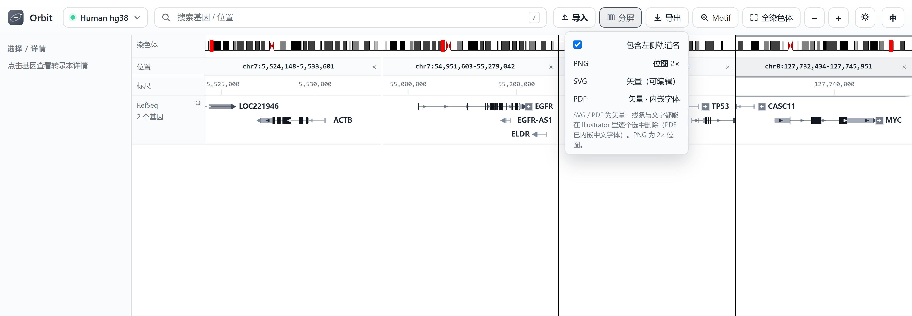
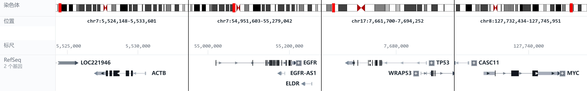

Exporting figures
=====================

Export includes the visible track drawing, with optional track-name labels.
It is **not a screenshot of the entire application**: the toolbar, navigation
sidebar and settings popovers are excluded.

Step-by-step example
------------------------

1. Arrange your loci, for example ``ACTB, EGFR, TP53, MYC`` in four panels
   (see :doc:`navigation`).
2. Choose the desired gene expansion state, colours and signal scale. Hide
   tracks you do not need using the sidebar checkboxes.
3. Click **Export** in the toolbar. Leave **Include left track names** checked
   to retain the track-name column; clear it for a drawing-only figure.
4. Choose **PNG**, **SVG** or **PDF**. Wait for the export-complete notification
   and use the normal download/save location for your browser or desktop build.
5. Inspect the exported file before adding it to a manuscript: check labels,
   each panel's locus, and whether the signal scales should be comparable.

   Actual Export menu for a multi-gene view. The include-labels checkbox
   controls the track-name column, not the application sidebar.

   Example plot composed from the same four panels. It retains the genomic
   tracks but omits the toolbar and application sidebar.

Choose a format
-------------------

.. list-table::
   :header-rows: 1
   :widths: 15 35 50

   * - Format
     - Best use
     - What to expect
   * - PNG
     - Slides, email, documents
     - The app renders a 2× raster plot. Pixel dimensions, not a DPI label
       alone, determine how much detail it contains.
   * - SVG
     - Editable illustration
     - Vector exon blocks, arrows, signal primitives and text. Open in a vector
       editor to adjust individual objects; keep the original file.
   * - PDF
     - Publication or sharing
     - Vector drawing with an embedded system font when available. If font
       loading fails, Orbit explicitly falls back to a raster PDF.

PNG resolution and 300 DPI
------------------------------

For a 300-DPI figure, required pixels = printed width in inches × 300. A
12.8-inch-wide figure needs 3840 pixels. Merely changing a 1280-pixel image's
DPI metadata does not create more detail. Prefer SVG/PDF when you need arbitrary
rescaling. The manual's new screenshots were captured at 3× device scale and
saved with 300-DPI metadata; that is separate from the app's 2× PNG export.

What is included
--------------------

Visible tracks are composed in their screen order, including imported BAM,
signal, annotation and FASTA tracks. Multi-panel plots retain all panel drawing
regions. Hidden tracks are omitted. Track names are optional; settings menus
are not exported. A plot is more reliable than a whole-window screenshot when
you want only the genomic data.

The SVG/PDF renderer replays the drawing into vector primitives rather than
embedding a screen bitmap. Signal rendering can produce many rectangles or
paths; do not assume it is one editable path per sample. Fonts and labels
should still be checked in the target illustration editor.

There is no separate batch-export interface. To export several loci together,
use up to **five panels** and export once; for separate figures, navigate and
export one locus at a time.
