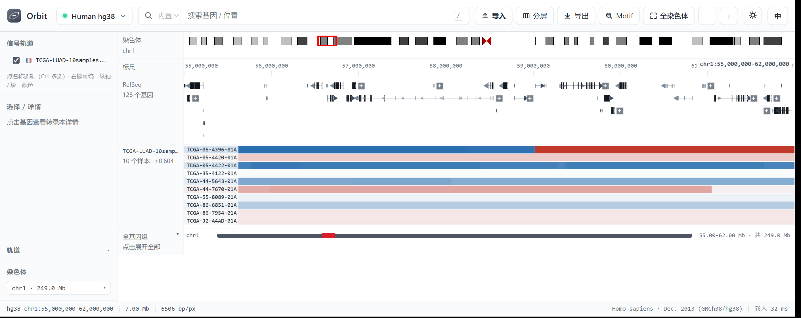
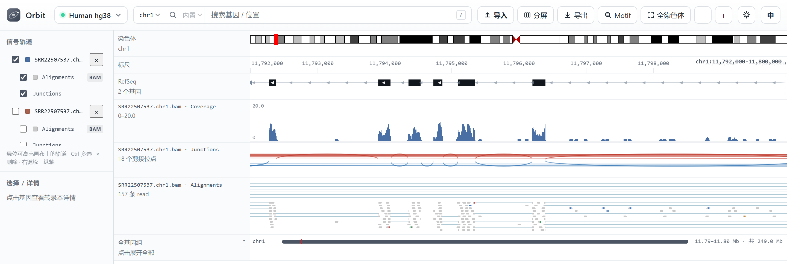
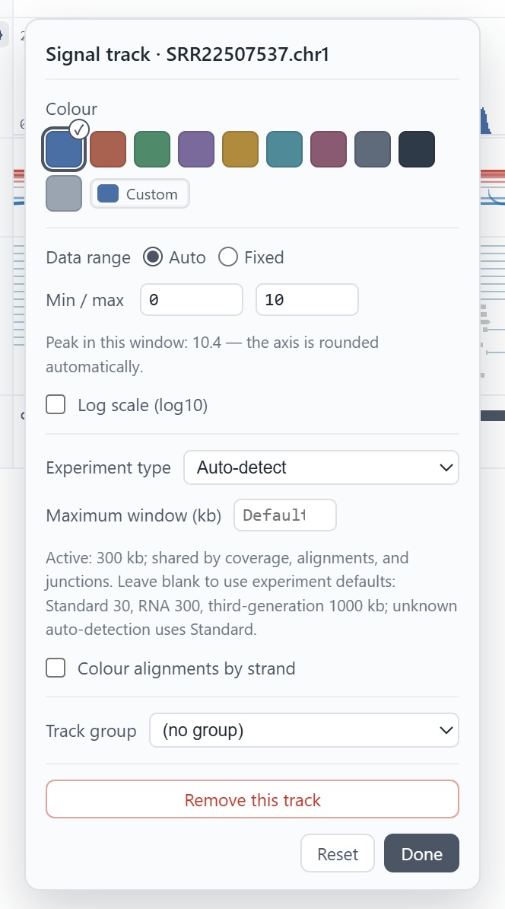
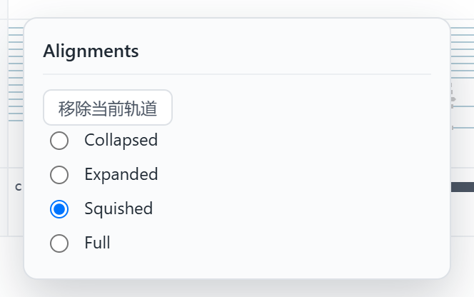
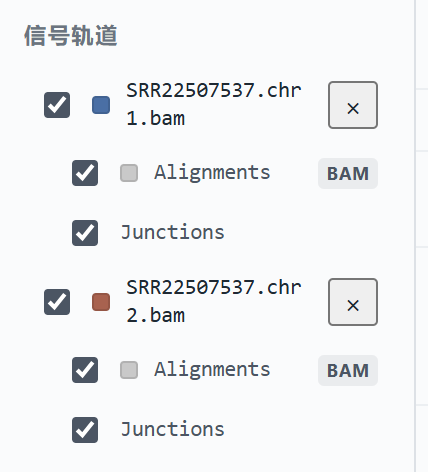

Importing data
==============

Orbit reads the common genomics formats directly. Drag a file onto the window,
or press the **Import** button in the toolbar. The format is chosen by
extension.

Supported formats
-----------------

.. list-table::
   :header-rows: 1
   :widths: 16 26 58

   * - Format
     - Extension
     - Notes
   * - bigWig
     - ``.bw`` ``.bigWig``
     - Random access, no indexing step. Best choice for signal.
   * - bedGraph
     - ``.bedGraph`` ``.bdg``
     - Loaded into memory; fine up to a few hundred MB.
   * - WIG
     - ``.wig`` ``.wiggle``
     - ``variableStep`` and ``fixedStep``; stored as intervals like bedGraph.
   * - SEG
     - ``.seg`` ``.seg.txt`` ``.seg.tsv``
     - Copy-number segments (GISTIC / TCGA / GDC); one file may hold many samples.
   * - BAM
     - ``.bam``
     - Uses the neighbouring ``.bai``; builds its own index once if there is none.
   * - SAM
     - ``.sam``
     - Text alignments: same coverage, junction and read views as BAM.
   * - GTF / GFF3
     - ``.gtf`` ``.gff`` ``.gff3``
     - Becomes a gene track; UTR and CDS features are kept.
   * - FASTA
     - ``.fa`` ``.fasta``
     - Adds an independent sequence track for matching genomic coordinates.

bigWig
------

The recommended format. Orbit parses the index itself, so there is no
``bigWigToBedGraph`` step and no conversion. Multi-sample overlays work best
when the files share a coordinate system.

.. code-block:: text

   Import → select SRR1234.bw

The track appears immediately with autoscale on. Open its label to pin the
range if you want several samples to share one scale.

.. figure:: examples/import-bigwig.png
   :align: center
   :width: 100%

   A local ``.bw`` signal track imported onto hg38. The signal is added to the
   signal panel with autoscale on, and its label (``Scr_R1_IP``) appears in the
   left sidebar. Its filename alone does not establish the experimental assay.

bedGraph
--------

Plain text, four columns (``chrom  start  end  value``). Convenient for small,
hand-made tracks; a genome-wide file will cost memory, so prefer bigWig above a
few hundred megabytes. Orbit renders bedGraph exactly like bigWig — same signal
panel, same autoscale, same colour controls.

.. code-block:: text

   Import → select sample.bedGraph

.. figure:: examples/import-bedgraph.png
   :align: center
   :width: 100%

   A four-column ``.bedGraph`` file on hg38, rendered identically to a bigWig
   signal track. Both go through the same drawing path, so you can mix ``.bw``
   and ``.bedGraph`` in one view.

WIG
---

Wiggle files are accepted in both layouts: ``variableStep`` (``position value``
pairs) and ``fixedStep`` (``start`` / ``step`` / ``span``, with one value per
line). Each probe becomes a small interval, so binning, autoscale and colours
behave exactly like bedGraph. A plain four-column body is also tolerated.

.. code-block:: text

   Import → select sample.wig

.. note::

   WIG carries no chromosome lengths, so the track reports its extent from the
   data itself. Coordinates in the file are 1-based, as the format requires.

SEG
---

SEG is the tab-delimited copy-number segment format written by GISTIC, TCGA
and the GDC: ``Sample  Chromosome  Start  End  Num_Probes  Segment_Mean``.
Orbit identifies the columns by header name, so the GDC spelling
(``GDC_Aliquot``) and either ``Segment_Mean`` or ``seg.mean`` are accepted, and
``.seg`` / ``.seg.txt`` / ``.seg.tsv`` (also gzip-compressed) all work. A plain
``.txt`` or ``.tsv`` is accepted too, as long as the first line carries the SEG
column names — that is how names like ``xxx.seg.v2.txt`` are recognised.
``Segment_Mean`` is a log2 ratio: ``0`` is diploid, positive is gain and
negative is loss.

A file holding one sample becomes a two-colour bar track whose axis is
symmetric around zero, so a gain and a loss of the same magnitude are equally
tall. A file holding many samples becomes a heatmap instead — one row per
sample, one column per genomic bin — so a cohort can be compared in a single
track.

.. code-block:: text

   Import → select TCGA-LUAD-10samples.seg.txt

   Ten TCGA-LUAD copy-number segments in one file, drawn as a heatmap on hg38
   at ``chr1:55–62 Mb``. Each row is one aliquot; red is gain, blue is loss.
   The track label reports the sample count and the current amplitude.

Right-click the track (or use its gear) for **Heatmap colours (gain / loss)**
and **Amplitude ±**. Left on automatic, the amplitude is the 95th percentile of
``|Segment_Mean|`` inside the current window, clamped to 0.1–3 — a single
homozygous deletion (``-9``) therefore cannot flatten the rest of the cohort.

.. note::

   The SEG file stays in the sidebar after a restart but is not re-parsed
   until you tick it again — see :ref:`imports-are-session-scoped`. Removing the
   track deletes the imported copy under ``data/loaded``; your original file is
   untouched.

BAM
---

Orbit reads BAM through a BAI index. If ``sample.bam.bai`` sits next to the file
it is used as-is; if there is none, or the one present does not match the BAM,
Orbit builds its own index once and caches it next to the imported copy. Only
BAI is understood — CSI indexes are not read, so convert them or let Orbit build
a BAI.

Every read in the window is returned: no sampling, no "first N" cap. That is why
a wide window on a deep library takes a moment; zoom in and the request shrinks
with the window.

.. code-block:: text

   Import → select sample.bam

Three rows per file
~~~~~~~~~~~~~~~~~~~

One BAM adds three adjacent rows, and all three carry the file name so several
imported BAMs stay distinguishable:

``sample.bam · Coverage``
   Read depth as bars, scaled to the window.

``sample.bam · Junctions``
   Spliced reads as arcs, red for the forward strand and blue for the reverse.
   The arc height grows with the number of supporting reads.

``sample.bam · Alignments``
   The reads themselves, with mismatch marks and ``N`` gaps.

   One BAM on hg38 at ``chr1:11,792,000-11,800,000``: Coverage, Junctions and
   Alignments, each labelled with the file name. The bundled RefSeq track sits
   above for context.

When to draw them
~~~~~~~~~~~~~~~~~

Coverage, junctions and alignments share one visibility rule, taken from IGV:
30 kb for a standard library, 300 kb for RNA-seq and 1000 kb for third-generation
reads. Orbit estimates the experiment type from the first reads it sees (read
length, spliced-read fraction, CIGAR complexity); the result is shown in the
track settings, where it can be overridden, together with an explicit maximum
window.

   The BAM settings popover in English. **Experiment type** drives the window
   (``Active: 300 kb`` here); **Maximum window (kb)** overrides it for this track
   only. Colour, range and grouping work as for any signal track.

Zooming past the limit replaces the rows with a "zoom in to see alignments"
hint instead of drawing thousands of unreadable reads.

Display modes for reads
~~~~~~~~~~~~~~~~~~~~~~~

Right-click the **Alignments** row (or its label) for the four IGV modes:

``Collapsed``
   One row, reads drawn on top of each other.

``Expanded``
   One row per non-overlapping read, 13 px.

``Squished``
   The same packing at 5 px per row. This is the default.

``Full``
   One row per read, including reads that overlap.

   The Alignments menu. ``Squished`` is selected by default;
   **Remove current track** hides this row only and keeps the BAM.

No mode samples: every read that passes the filters is in the layout, and the
mode only changes how many of them fit on screen.

Browsing every read
~~~~~~~~~~~~~~~~~~~

Rows that do not fit are scrolled, not discarded. Put the pointer inside the
Alignments row and use the wheel; the label reports the visible range, for
example ``157 reads · rows 16-39 / 157 · scroll up/down``. A thin bar on the
right edge shows where you are. :kbd:`Ctrl` + wheel still zooms.

Only the visible rows are drawn, so a window with tens of thousands of reads
scrolls without re-reading the file.

Hiding one row at a time
~~~~~~~~~~~~~~~~~~~~~~~~

Each of the three rows has its own checkbox in the sidebar, nested under the
BAM. Hiding **Junctions** or **Alignments** leaves coverage in place, and the
parent BAM switch still hides the whole group. **Remove current track** in the
row's menu does the same as unchecking it: the row disappears, the BAM stays
imported, and the checkbox brings it back.

   Two BAMs in the sidebar, each with its own Alignments and Junctions
   switches. The file names wrap, so ``chr1`` and ``chr2`` stay visible.

Which reads are drawn
~~~~~~~~~~~~~~~~~~~~~

Unmapped (``0x4``), vendor-QC-failed (``0x200``) and duplicate (``0x400``) reads
are skipped — the IGV default. Secondary (``0x100``) and supplementary
(``0x800``) alignments are kept, because IGV does not filter those either.
Coverage counts ``M``, ``=`` and ``X``; ``N`` and ``D`` advance the reference
without adding depth, and ``I`` / ``S`` do not advance it.

SAM
~~~

``.sam`` files (the plain-text form of BAM) produce the same three rows. Reads
surviving the default filters are kept, including secondary and supplementary
records. ``D``/``N`` and ``I`` CIGAR operations are preserved, and coverage is
computed from the aligned blocks rather than the whole ``start``–``end`` span.
Chromosome lengths come from the ``@SQ`` header when present. SAM is parsed into
memory at import, so prefer BAM for very large alignment sets.

.. note::

   The same flag defaults apply to SAM: unflagged primary, secondary and
   supplementary records are drawn, while unmapped, QC-failed and duplicate
   records are skipped.

GTF / GFF3
----------

1. Choose the matching assembly: **hg38** for GRCh38 or **sacCer3** for the
   yeast example below.
2. Click Import, select the GTF/GFF3, and wait for parsing to finish.
3. Enable its annotation row. Use the dedicated imported-annotation search
   controls when a gene exists only in your imported file, not in RefSeq.
4. Click its small **+** to expand a gene, or the track's gear for **Expand all**.
   The procedure and a before/after illustration are in :doc:`navigation`.

Imported annotations become a normal gene track: expandable transcripts,
strand colours and labels. Chromosome aliases such as ``1`` / ``chr1`` or
``I`` / ``chrI`` are reconciled, but aliases do not convert genome assemblies.

.. code-block:: text

   Import → select annotation.gtf

.. figure:: examples/import-gtf.png
   :align: center
   :width: 100%

   A yeast GTF (``representative_transcripts.gtf``) imported onto sacCer3 and
   shown directly under the bundled RefSeq track. Gene names and strand arrows
   are drawn for both.

.. note::

   Imported annotations are not converted to the built-in binary format. They
   are read on load, which is fine for a few hundred thousand features but
   slower than the bundled RefSeq index.

FASTA
-----

Importing FASTA adds its own sequence track; it does not replace the backend
reference for built-in GC, motif or BAM mismatch calculations. Uncompressed
FASTA uses indexed file reads. A gzip FASTA is decompressed into memory, so
whole-human-genome gzip imports can consume several GB of RAM.

For the complete human-genome walkthrough, with exact positive/negative-strand
start/stop windows, Flip strand and amino-acid translation, see :doc:`sequence`.

.. figure:: examples/sequence-actb-start-flipped.png
   :width: 100%
   :alt: Local human FASTA displayed at ACTB with complementary-strand translation

   An imported GRCh38 chromosome FASTA at base resolution. The detailed
   sequence guide explains why a negative-strand gene must be read right to left
   after flipping the displayed bases.

Where imported tracks live
--------------------------

Importing copies the file into Orbit's per-user data directory
(``data/loaded``, or ``%LOCALAPPDATA%/Orbit/loaded`` when the install
directory is read-only).
The imported copy is used for display; keep your original research files as
backups. Remove a track only when you intend to remove its imported copy.

.. _imports-are-session-scoped:

Imports are session-scoped
~~~~~~~~~~~~~~~~~~~~~~~~~~

A launch opens nothing. The imported copies stay under ``data/loaded`` and the
registration list is kept, but no file is parsed, indexed or drawn until you
import it again in that session, so a 900 MB BAM cannot delay the window from
appearing. Importing the same file again replaces its stored copy in place
instead of creating a second ``_2`` entry.

Set ``IGV_RESTORE_LOADED=1`` before launching to reopen everything that was
imported last time — that is the behaviour of a normal genome browser, and it
costs the startup time this default avoids. ``start-orbit.bat`` explicitly sets
it to ``0``.
