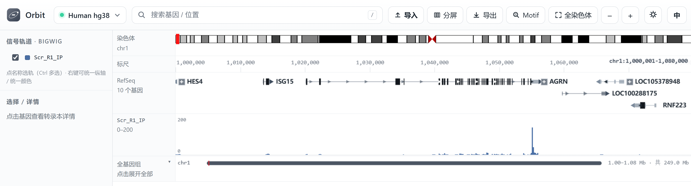
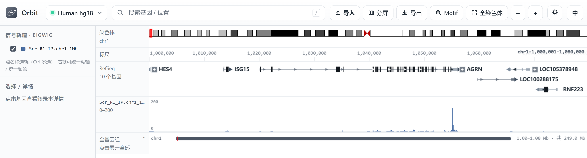
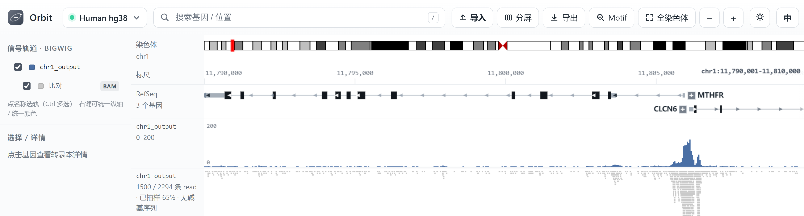
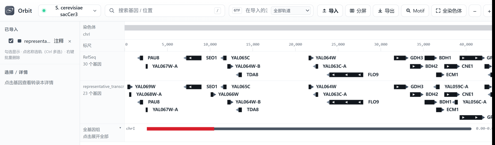
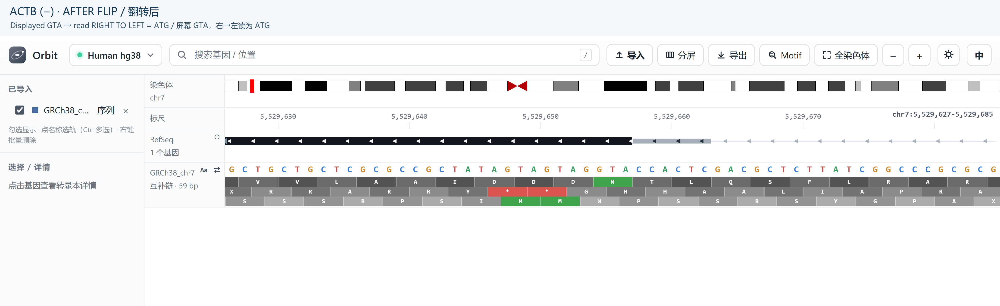

Importing data
==============

Orbit reads the common genomics formats directly. Drag a file onto the window,
or press the **Import** button in the toolbar. The format is chosen by
extension.

Supported formats
-----------------

.. list-table::
   :header-rows: 1
   :widths: 16 26 58

   * - Format
     - Extension
     - Notes
   * - bigWig
     - ``.bw`` ``.bigWig``
     - Random access, no indexing step. Best choice for signal.
   * - bedGraph
     - ``.bedGraph`` ``.bdg``
     - Loaded into memory; fine up to a few hundred MB.
   * - WIG
     - ``.wig`` ``.wiggle``
     - ``variableStep`` and ``fixedStep``; stored as intervals like bedGraph.
   * - BAM
     - ``.bam``
     - Scanned into an in-memory index during import; a ``.bai`` is not used.
   * - SAM
     - ``.sam``
     - Text alignments: same coverage and stacked-reads view as BAM.
   * - GTF / GFF3
     - ``.gtf`` ``.gff`` ``.gff3``
     - Becomes a gene track; UTR and CDS features are kept.
   * - FASTA
     - ``.fa`` ``.fasta``
     - Adds an independent sequence track for matching genomic coordinates.

bigWig
------

The recommended format. Orbit parses the index itself, so there is no
``bigWigToBedGraph`` step and no conversion. Multi-sample overlays work best
when the files share a coordinate system.

.. code-block:: text

   Import → select SRR1234.bw

The track appears immediately with autoscale on. Open its label to pin the
range if you want several samples to share one scale.

   A local ``.bw`` signal track imported onto hg38. The signal is added to the
   signal panel with autoscale on, and its label (``Scr_R1_IP``) appears in the
   left sidebar. Its filename alone does not establish the experimental assay.

bedGraph
--------

Plain text, four columns (``chrom  start  end  value``). Convenient for small,
hand-made tracks; a genome-wide file will cost memory, so prefer bigWig above a
few hundred megabytes. Orbit renders bedGraph exactly like bigWig — same signal
panel, same autoscale, same colour controls.

.. code-block:: text

   Import → select sample.bedGraph

   A four-column ``.bedGraph`` file on hg38, rendered identically to a bigWig
   signal track. Both go through the same drawing path, so you can mix ``.bw``
   and ``.bedGraph`` in one view.

WIG
---

Wiggle files are accepted in both layouts: ``variableStep`` (``position value``
pairs) and ``fixedStep`` (``start`` / ``step`` / ``span``, with one value per
line). Each probe becomes a small interval, so binning, autoscale and colours
behave exactly like bedGraph. A plain four-column body is also tolerated.

.. code-block:: text

   Import → select sample.wig

.. note::

   WIG carries no chromosome lengths, so the track reports its extent from the
   data itself. Coordinates in the file are 1-based, as the format requires.

BAM
---

Orbit scans the BAM during import and builds an in-memory interval index;
``.bai`` is not required or consumed by this implementation. Initial import
costs time and memory. The current loader caps accepted reads at 6,000,000;
check the truncation notice for larger files. Coverage and displayed reads
are then queried for the visible window, and dense alignments may be sampled.

Reads that are unmapped (``0x4``), fail vendor QC (``0x200``) or carry the
duplicate flag (``0x400``) are not drawn — the same default as IGV. Secondary
(``0x100``) and supplementary (``0x800``) alignments are kept, because IGV never
filters those.

.. code-block:: text

   Import → select sample.bam

The sidebar has a parent signal switch and a subordinate alignment switch:
turn the parent on to see coverage, then enable the alignment switch for reads.
Turning the parent off hides both; reads are not independent of the parent.

SAM
~~~

``.sam`` files (the plain-text form of BAM) are parsed the same way and appear
with an identical coverage row plus stacked reads. Reads surviving the default
filters are kept, including secondary and supplementary records (flags ``0x100``
/ ``0x800``) — IGV does not filter those either: the Java implementation never tests the
flags, and igv.js keeps them unless ``secondary`` / ``supplementary`` filtering
is explicitly enabled. ``D``/``N`` and ``I`` CIGAR operations are preserved.
Chromosome lengths come from the ``@SQ`` header when present. SAM is read into
memory at import, so use BAM for very large alignment sets.

.. note::

   The same flag defaults apply to SAM: unflagged primary, secondary and
   supplementary records are drawn, while unmapped, QC-failed and duplicate
   records are skipped.

   A BAM imported onto hg38, shown at ``chr1:11.79–11.81 Mb``. The blue track is
   read coverage; the striped block below it is the stacked alignments. The
   bundled RefSeq track (``MTHFR``, ``CLCN6``) sits above for context.

GTF / GFF3
----------

1. Choose the matching assembly: **hg38** for GRCh38 or **sacCer3** for the
   yeast example below.
2. Click Import, select the GTF/GFF3, and wait for parsing to finish.
3. Enable its annotation row. Use the dedicated imported-annotation search
   controls when a gene exists only in your imported file, not in RefSeq.
4. Click its small **+** to expand a gene, or the track's gear for **Expand all**.
   The procedure and a before/after illustration are in :doc:`navigation`.

Imported annotations become a normal gene track: expandable transcripts,
strand colours and labels. Chromosome aliases such as ``1`` / ``chr1`` or
``I`` / ``chrI`` are reconciled, but aliases do not convert genome assemblies.

.. code-block:: text

   Import → select annotation.gtf

   A yeast GTF (``representative_transcripts.gtf``) imported onto sacCer3 and
   shown directly under the bundled RefSeq track. Gene names and strand arrows
   are drawn for both.

.. note::

   Imported annotations are not converted to the built-in binary format. They
   are read on load, which is fine for a few hundred thousand features but
   slower than the bundled RefSeq index.

FASTA
-----

Importing FASTA adds its own sequence track; it does not replace the backend
reference for built-in GC, motif or BAM mismatch calculations. Uncompressed
FASTA uses indexed file reads. A gzip FASTA is decompressed into memory, so
whole-human-genome gzip imports can consume several GB of RAM.

For the complete human-genome walkthrough, with exact positive/negative-strand
start/stop windows, Flip strand and amino-acid translation, see :doc:`sequence`.

   An imported GRCh38 chromosome FASTA at base resolution. The detailed
   sequence guide explains why a negative-strand gene must be read right to left
   after flipping the displayed bases.

Where imported tracks live
--------------------------

Importing copies the file into Orbit's per-user data directory
(``data/loaded``, or ``%LOCALAPPDATA%/Orbit/loaded`` when the install
directory is read-only).
The imported copy is used for display; keep your original research files as
backups. Remove a track only when you intend to remove its imported copy.
Imported tracks are session-scoped by default: set ``IGV_RESTORE_LOADED=1`` to
restore them on the next server launch. Restored tracks may still need to be
checked on in the sidebar.
