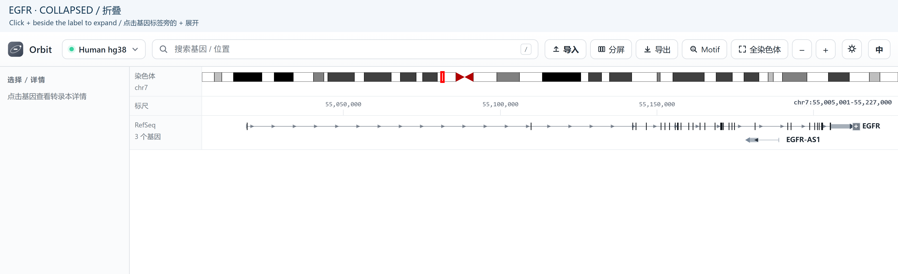
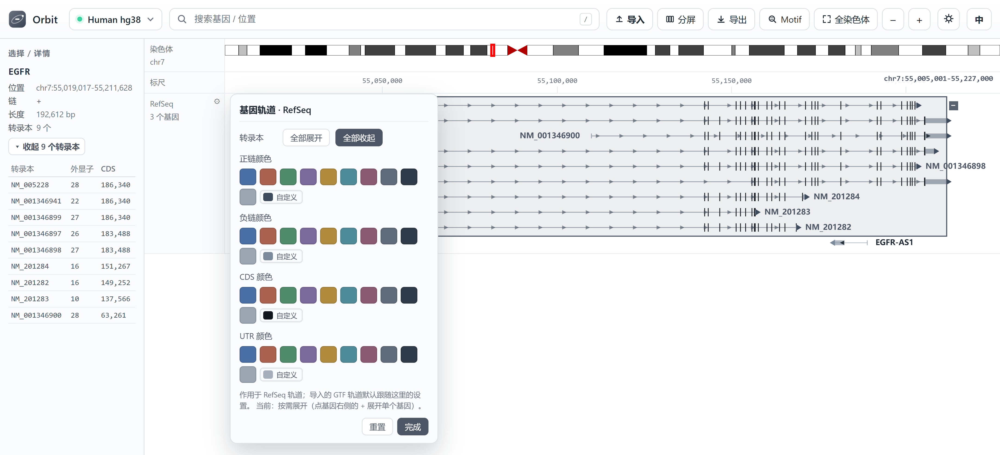
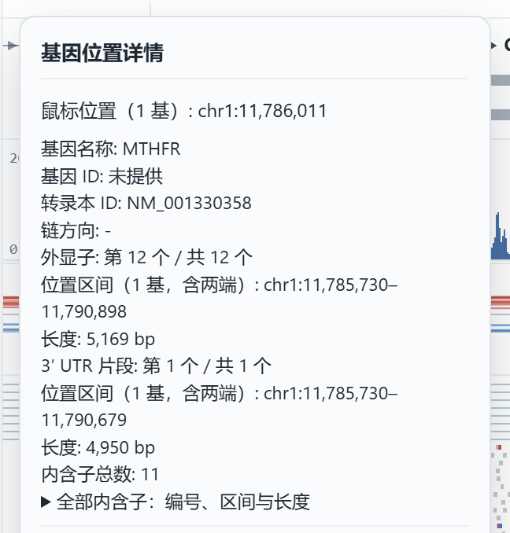
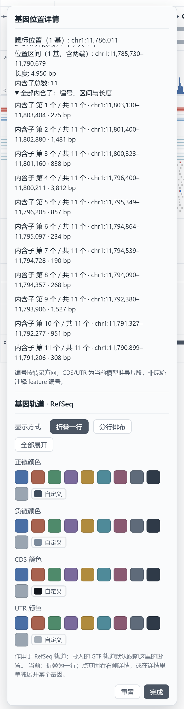
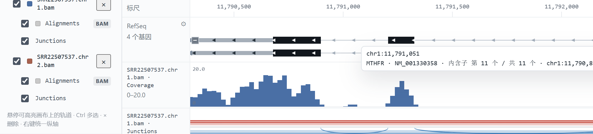
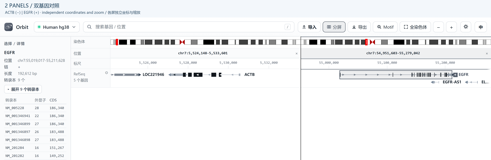

Navigation
==============

Search a gene or an exact interval, then choose how much detail to display.
Coordinates typed into Orbit are **1-based, inclusive**. The examples below use
**human hg38 / GRCh38**; do not reuse them on hg19.

Search and zoom
-------------------

1. Select **hg38** in the assembly menu.
2. Type ``EGFR`` and press :kbd:`Enter` to open the gene. Select a suggestion
   when several names match; entering the same text again is not a next-hit command.
3. Paste ``chr7:55,019,250-55,019,308`` to inspect its start-codon region.
4. Use the wheel or toolbar zoom controls to change scale. Drag a track to pan;
   dragging is not an interval-selection gesture. Double-click to zoom in
   around the pointer. :kbd:`/` focuses the search box.

The search also accepts ``chr7``, ``chr7:55,019,278``, and coordinate ranges
without thousands separators. Zooming below one base per pixel is supported;
this is necessary to make individual base letters readable. See :doc:`sequence`
for nucleotide and amino-acid views.

.. figure:: examples/interface-overview.png
   :width: 100%
   :alt: ACTB locus showing the toolbar, track labels and gene model

   A complete locus view. The assembly and search controls are at the top;
   track settings are beside the drawing, and the sidebar holds visibility
   switches and the selected-gene details.

Expand and collapse a gene
------------------------------

1. Search ``EGFR``. In the RefSeq drawing, find the small **+** beside its label.
   Clicking the gene body or name selects it; it does not by itself expand it.
2. Click **+** to show the individual transcript rows. The symbol becomes **−**.
3. Compare transcript accessions (for example ``NM_005228``), exon blocks,
   intron connectors and coding regions. Different isoforms can have different
   exon structures and CDS boundaries.
4. Click **−** in the same place to collapse the transcript rows back to the
   merged gene model. A gene with only one transcript has no +/− expansion control.

   Before expansion: one merged EGFR model. Use the small + control, not an
   arbitrary point on an exon, to open the transcript list.

.. figure:: examples/genes-expanded.png
   :width: 100%
   :alt: EGFR expanded into separate named transcript rows

   After expansion: EGFR isoforms occupy separate rows with their transcript
   accessions. The − control collapses them again; the locus and zoom are unchanged.

Expand or collapse the entire track
~~~~~~~~~~~~~~~~~~~~~~~~~~~~~~~~~~~~~~~

Click the **gear beside RefSeq**, then choose **Expand all** or **Collapse all**.
Expand all also applies to genes that become visible after panning. You can
still collapse an individual gene using its − control. Imported GTF/GFF3 gene
tracks have their own gear and independent expansion state. Shift-click is not
an expand-all shortcut. Do not rely on expansion surviving a new app launch.

   The actual gene-track settings: expansion controls and colours for strands,
   CDS and UTR. The setting affects the chosen track, not every annotation file.

Feature details at the pointer
------------------------------

Right-click a gene model in **RefSeq** or in an imported GTF/GFF3 track. The
popover names what is exactly under the pointer:

   Right-clicking the first exon of ``MTHFR`` (minus strand). The pointer is on
   exon 12 of 12 — numbering follows the transcript, so the leftmost exon is the
   last one on a minus-strand gene. The 3′ UTR fragment and the intron count are
   listed below it.

The fields are:

* **Gene name** and **Gene ID**. The ID is shown only when the annotation stores
  one; the bundled RefSeq index keeps names, so it reads *not provided* there.
* **Transcript ID** and **strand**. A position covered by several transcripts
  lists one block per transcript instead of picking one.
* **Exon**, **CDS fragment**, **5′/3′ UTR fragment** or **intron**, each as
  *n of m*, with its 1-based inclusive interval and its length.
* **Total introns** for that transcript.

Intervals are 1-based and inclusive, matching the search box; the underlying
model is 0-based half-open. CDS and UTR fragments are derived from the exon
list plus the CDS start/end of the transcript, so their numbering is the
fragment number in this model, not the feature number in the original file.

Every intron, not only the one under the pointer
~~~~~~~~~~~~~~~~~~~~~~~~~~~~~~~~~~~~~~~~~~~~~~~~

The list of introns is collapsed by default. Opening it shows all of them in
transcript order with coordinates and lengths, so you can read a splice
structure without hunting for each gap:

   All 11 introns of ``NM_001330358``, numbered from the 5′ end of the
   transcript. The entry under the pointer is bold.

Hovering an intron without clicking shows the same information in a tooltip:

   ``Intron 11 of 11 · chr1:11,790,899–11,791,206 · 308 bp``. One line per
   transcript when several share the position.

The popover can be dragged by its title bar and stays inside the window; its
content scrolls when the intron list is long.

Compare several genes in panels
-----------------------------------

Orbit supports **1–5 panels**. Loci and zoom levels are independent; track files
and track-level settings are shared. A panel is not a separate sample import.

Two-panel example: ACTB and EGFR
~~~~~~~~~~~~~~~~~~~~~~~~~~~~~~~~~~~~

1. Open **Split view** in the toolbar and choose **2 panels**.
2. In the position input above the first panel, type ``ACTB`` and press Enter.
3. In the second panel input, type ``EGFR`` and press Enter.
4. Zoom or pan within one panel to compare detail without moving the other.
   Click its header to select the target panel for shared toolbar navigation.
5. Use the **×** in a panel header to close that panel, or choose one panel in
   the split menu to return to a single view.

   ACTB (negative strand) and EGFR (positive strand) in two panels. Each has
   its own position field and coordinate scale: aligned screen columns do not
   mean the same genomic coordinate.

Four-panel example
~~~~~~~~~~~~~~~~~~~~~~

Choose **4 panels**, then enter ``ACTB``, ``EGFR``, ``TP53`` and ``MYC`` in their
respective header inputs. Alternatively, enter ``ACTB, EGFR, TP53, MYC`` in the
main search box to open multiple loci. Check the pane count and gene names
before exporting. Ctrl+number is not a supported panel-focus shortcut.

.. figure:: examples/panels-four.png
   :width: 100%
   :alt: Four panels comparing ACTB EGFR TP53 and MYC

   Four real gene loci side by side. The view makes gene structures easy to
   compare, while every panel retains its own zoom and chromosome.

Whole-genome overview and links
-----------------------------------

Enable the whole-genome overview from the sidebar track list. Its chevron
expands the primary-chromosome bars; their count depends on the chosen species.
Click a bar to navigate. In split view each panel draws its own overview and
current-window marker.

In browser mode a locus can be opened with a URL such as::

   http://127.0.0.1:8765/?db=hg38&locus=chr7:5526400-5531300

Use the search box inside the native desktop window when no address bar is shown.
