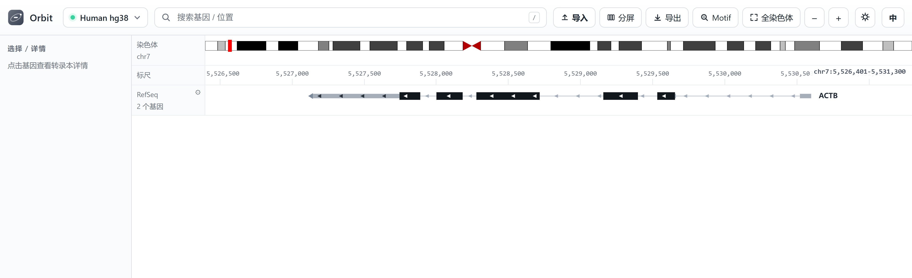
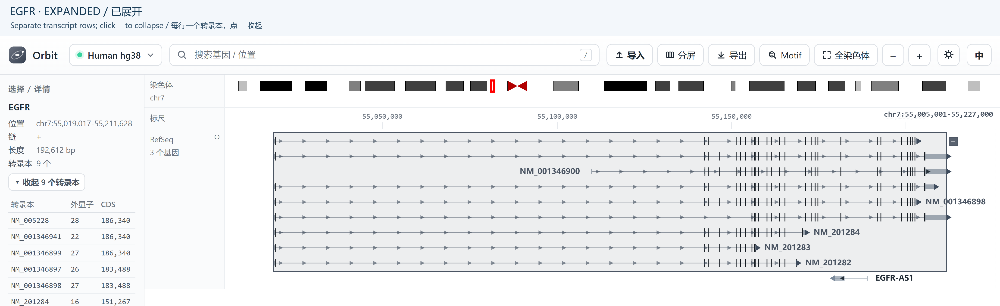
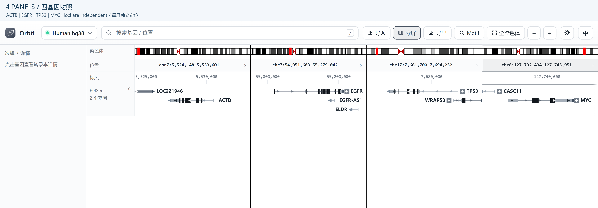

Quick start
===========

From launch to an exported figure: choose the correct assembly, find a locus,
inspect transcripts, import experimental data, and compare or export the view.
The examples below use the human ``hg38`` assembly.

1. Choose an assembly
---------------------

1. Click the assembly name beside the Orbit logo in the top toolbar.
2. Select **hg38** from the assembly list and wait for the assembly label and
   annotation to update.
3. Check the assembly before searching or importing data. Your experimental
   files must use the same coordinate system; changing the selector does not
   convert a file between assemblies.

Changing assembly opens that assembly's default region, not the previous
locus. Repeat your search after an assembly change. See :doc:`assemblies` for
assembly names and sequence availability.

2. Open a locus
---------------

Click the main search box, type ``TP53``, and press :kbd:`Enter`. Suggestions
appear while you type; click a result or use :kbd:`↑` / :kbd:`↓` and
:kbd:`Enter` to choose one. A gene search opens the gene with flanking context.
You can also enter a coordinate with its chromosome name:

.. code-block:: text

   chr17:7,668,402-7,687,550
   chr17:7668402-7687550

Search coordinates are 1-based, with an inclusive end. Do not omit the
chromosome name. Drag horizontally in a track canvas to pan; use the mouse
wheel to zoom around the pointer, double-click to zoom in, or click **+** /
**-** in the toolbar to zoom around the centre.

   This overview shows the complete ``ACTB`` gene on hg38. Start at the top-left
   assembly selector, then use the adjacent search box. Import, Split, and
   Export are separate toolbar buttons; track visibility and selected-gene
   details are controlled in the left sidebar.

3. Look at the tracks
---------------------

Expand **Tracks** in the left sidebar to reveal the built-in checkboxes.
Ideogram, Ruler, RefSeq genes, and the compact whole-genome overview are on by
default. **GC content** and **Sequence** start off. They require a reference
sequence source for the assembly; their checkboxes are disabled if none is
available. After enabling Sequence, zoom in to approximately ``1.2 bp/px`` or
closer to see bases.

To see transcript structure:

1. Click the ``TP53`` model or its label in the canvas. **Selection / details**
   shows its coordinates, strand, length, and transcript table.
2. Click the small **+** beside the gene to expand its transcript rows; click
   **-** there to collapse it. A single-transcript gene has no expansion button.
   The sidebar also offers **Show / Hide transcripts** for the selected gene.
3. To expand the whole RefSeq track, click the **gear** in its track-label
   cell, choose **Expand all**, then **Done**. Choose **Collapse all** to
   return to merged gene models. The same controls exist on imported GTF/GFF
   gene tracks.

   The ``EGFR`` example on hg38 shows transcripts in separate rows instead of
   one merged gene model. Search ``EGFR`` to reproduce this view. Use the
   per-gene plus/minus button for one gene, or the track gear's Expand all /
   Collapse all buttons for the entire annotation track.

4. Load your own data
---------------------

1. With the matching assembly selected, click **Import** in the top toolbar
   and choose a local file, or drag the file onto the window. Accepted formats
   include bigWig, bedGraph, BAM, GTF/GFF, BED/peak files, and FASTA; see
   :doc:`data-import` for format-specific requirements.
2. Wait until the import progress panel reports completion. Signal files
   appear under **Signal tracks**; annotations and FASTA appear under
   **Imported**. Confirm that the new track's checkbox is on.
3. Navigate to a region covered by the file. A track with no data at ``TP53``
   is not necessarily an import failure. For imported GTF/GFF genes, use the
   second **GTF** search box and its track selector to search your annotation
   rather than the bundled RefSeq index.
4. For a signal or gene track, click its **gear** (or right-click its canvas
   track label) for settings. Signal settings include colour, automatic/fixed
   range, log scale, and grouping. Gene settings include transcript expansion
   and feature colours. FASTA rows instead have strand and translation buttons.

Use real files generated for your chosen reference assembly. The import
examples in :doc:`data-import` use ``Scr_R1_IP.bw`` (signal) and
``chr1_output.bam`` (alignments) on hg38. To inspect the BAM example, search
``MTHFR`` or ``CLCN6`` on chromosome 1, not ``TP53``. The annotation example
``representative_transcripts.gtf`` instead requires the yeast **sacCer3**
assembly. These filenames identify the example inputs; use your own local
files unless you have those datasets.

Importing copies files into Orbit's data area. On a fresh page load,
previously imported tracks remain listed but unchecked; tick them again
instead of assuming they were deleted.

Compare several loci
~~~~~~~~~~~~~~~~~~~~

Click **Split** and choose **1 panel** through **5 panels**. New panels
initially copy the active locus. Edit each panel's **Locus** field and press
:kbd:`Enter`, or enter ``TP53, BRCA1`` in the main search box to open those
matches side by side automatically (at most five terms).

Click a panel's position cell to make it active before using the main search,
keyboard navigation, or toolbar zoom. Dragging and pointer-based zoom operate
on the panel under the pointer. Close one panel with its **x** button or choose
**1 panel** to return to a single view. All panels share the assembly and track
list; their loci and zoom levels are independent.

   Four-panel comparison of ``ACTB``, ``EGFR``, ``TP53``, and ``MYC`` on hg38.
   Reproduce it by submitting ``ACTB, EGFR, TP53, MYC`` in the main search box.
   The Locus row supplies one coordinate input and close button per panel; its
   highlighted cell identifies the target of main-search and keyboard actions.

5. Export the view
------------------

1. Finish choosing visible tracks, transcript expansion, and panel positions.
2. Click **Export**, the download-arrow toolbar button immediately after
   **Split**.
3. Keep **Include track labels** checked for labelled track rows, or clear it
   for just the drawing area; then choose **PNG**, **SVG**, or **PDF**.
4. Save the file through the desktop save dialog or your browser's download
   handler. Export captures displayed track rows and all current panels, not
   the sidebar or toolbar.

PNG is a 2x raster image. SVG is editable vector output. PDF is vector with an
embedded font when a CJK font is available; otherwise Orbit reports a raster
PDF fallback. See :doc:`data-export` for details.

Keyboard essentials
-------------------

These navigation keys work when focus is outside text inputs and the Motif
dialog is closed. They affect the active panel.

.. list-table::
   :header-rows: 1
   :widths: 34 66

   * - Key
     - Action
   * - :kbd:`←` / :kbd:`→`
     - Pan left / right by 35% of the current window
   * - :kbd:`+` / :kbd:`=`
     - Zoom in twofold around the centre
   * - :kbd:`-` / :kbd:`_`
     - Zoom out twofold around the centre
   * - :kbd:`/`
     - Focus the main locus search box and select its contents
   * - :kbd:`Esc`
     - Dismiss settings/context popovers; outside an input, clear gene selection

.. tip::

   Use the toolbar **Export** button, not :kbd:`Ctrl+S`. Orbit does not bind
   :kbd:`Ctrl+F`, :kbd:`Ctrl+S`, or a special Shift-plus-arrow pan step.
