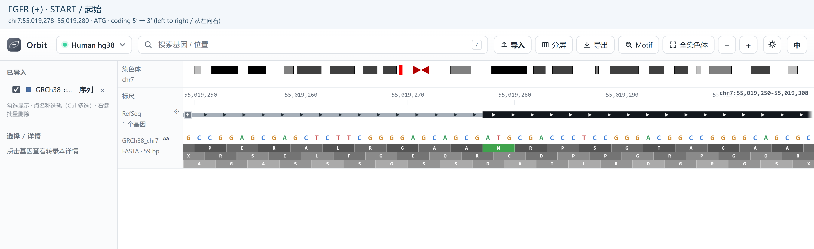
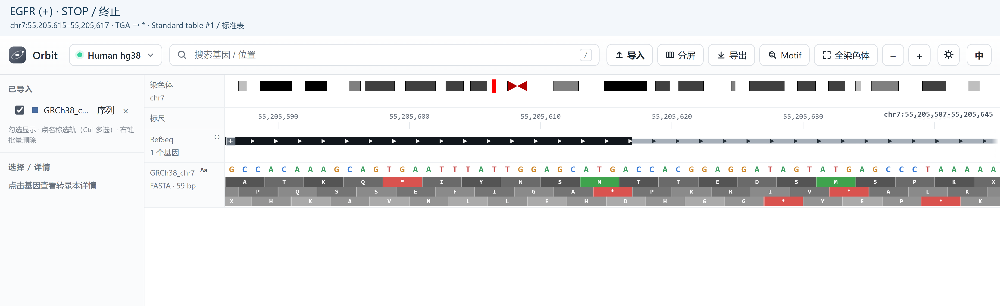
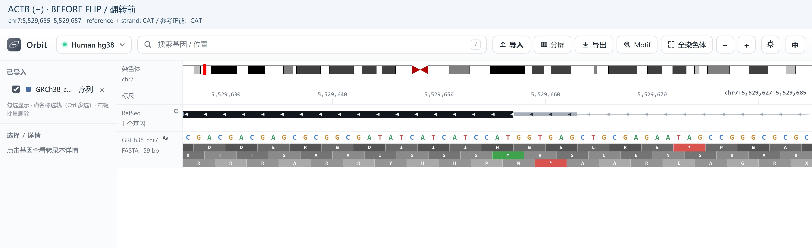
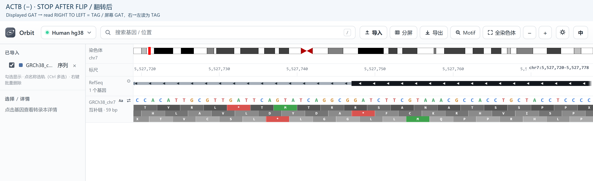
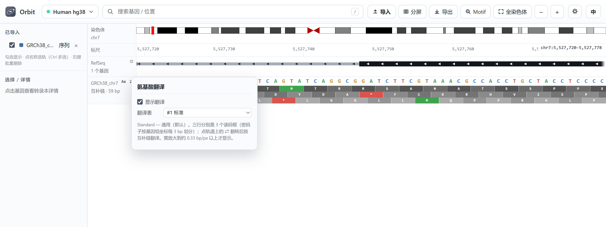
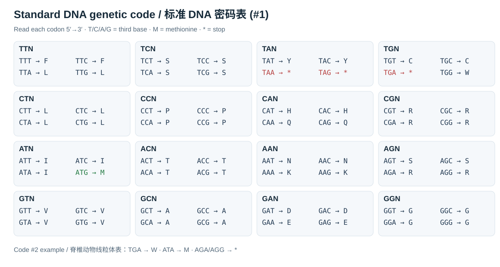
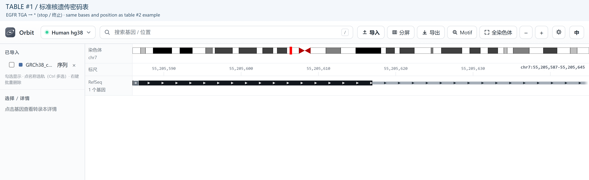

Local genome, strands and translation
=========================================

This walkthrough uses a local human **GRCh38 FASTA** and the bundled **hg38
RefSeq** annotation. The examples are DNA sequences (T rather than RNA U).
A FASTA supplies bases; it does not supply gene or transcript annotation.

Import your human genome FASTA
----------------------------------

1. Select **human hg38 / GRCh38** before loading the file. A GRCh37 FASTA must
   be paired with hg19 instead; a matching chromosome name alone is not enough.
2. Click **Import** and select your local
   ``Homo_sapiens.GRCh38.dna.primary_assembly.fa`` or another matching genome
   FASTA. Plain uncompressed FASTA is recommended for a large human genome.
3. Wait until parsing finishes. Enable the imported FASTA in the sidebar if
   it is hidden. It appears as its own sequence track, distinct from the built-in
   Sequence track. Ensembl ``7`` and UCSC ``chr7`` names are reconciled.
4. Search ``ACTB`` or ``EGFR``. At gene scale the FASTA track asks you to zoom
   in; that is expected, not a failed import.
5. Paste one of the narrow intervals below. Coloured bases appear at
   approximately 1.2 bp/pixel or closer; letters need about 8 pixels/base.
   A 59-base window is a useful starting point on a desktop screen.
6. Click **Aa** beside the imported FASTA, enable **Show translation**, and
   select **#1 Standard** for these human nuclear genes. Translation needs
   about 3 pixels/base or more. Each sequence track has its own Aa and flip state.

.. important::

   A local FASTA is an independent imported track. It does not replace the
   backend reference used by built-in GC, motif searches or BAM mismatch
   comparisons. To supply that backend reference offline, place a matching
   ``hg38.2bit`` in ``data/genomes``. A normal FASTA is read by indexed byte
   offsets; gzip FASTA is decompressed into memory, so a whole human ``.fa.gz``
   can require several GB of RAM. Importing also needs disk space for a copy.

The screenshots below use **chromosome 7 extracted unchanged from the local
GRCh38 primary-assembly FASTA**, imported as ``GRCh38_chr7.fa``. Header ``>7``
and original chromosome coordinates are retained. This is not a short sequence
renumbered from base 1, and no sequence was fabricated. Other chromosomes are
not present in that demonstration file; a full genome FASTA contains them.

   EGFR start region: local FASTA bases plus three translation frames below
   the RefSeq annotation. The Aa and double-arrow controls belong to the
   imported FASTA track; they do not automatically toggle other sequence tracks.

Choose a transcript before interpreting codons
--------------------------------------------------

Expand a gene with its small + control (see :doc:`navigation`) and identify the
transcript accession. For the examples we use **EGFR NM_005228** and
**ACTB NM_001101** in the bundled annotation. Isoforms can have different CDS
boundaries; a gene's outer boundary includes UTR and is not its start codon.

The coordinates in this table are **1-based inclusive**. They were checked
against the local FASTA and the selected transcript CDS boundaries.

.. list-table:: Verified hg38 examples
   :header-rows: 1
   :widths: 15 16 35 17 17

   * - Gene / strand
     - Boundary
     - Genomic bases
     - Reference + strand
     - Coding 5′→3′
   * - EGFR / +
     - Start
     - ``chr7:55,019,278-55,019,280``
     - ``ATG``
     - ``ATG``
   * - EGFR / +
     - Stop
     - ``chr7:55,205,615-55,205,617``
     - ``TGA``
     - ``TGA``
   * - ACTB / −
     - Start
     - ``chr7:5,529,655-5,529,657``
     - ``CAT``
     - ``ATG``
   * - ACTB / −
     - Stop
     - ``chr7:5,527,748-5,527,750``
     - ``CTA``
     - ``TAG``

Positive-strand example: EGFR
---------------------------------

1. Keep **Flip strand off** for the imported FASTA.
2. Paste ``chr7:55,019,250-55,019,308`` into the search box. The start triplet at
   55,019,278–55,019,280 is **ATG**, read left to right in the coding direction.
3. With Aa on, find the frame containing that triplet. It shows green **M**.
4. Paste ``chr7:55,205,587-55,205,645`` to inspect the selected transcript's
   terminal **TGA**. In Standard table #1 it is a red **\***, not an amino acid.

   EGFR stop region. Read the positive-strand DNA left to right. A stop symbol
   is meaningful for the selected CDS only in the correct reading frame.

Negative-strand example: ACTB and Flip strand
-------------------------------------------------

1. Paste ``chr7:5,529,627-5,529,685``. With flip off, the reference + strand at
   the start boundary reads **CAT** from left to right.
2. Click the **double-arrow (Flip strand)** beside the imported FASTA. The
   displayed letters become the complementary bases at the same coordinates:
   **CAT → GTA** when read left to right.
3. Coordinates still increase left to right. The negative coding strand runs
   **5′→3′ from right to left**, so that displayed GTA is read as **ATG**.
   The flipped translation uses the reverse-complement triplet and shows M.
4. Paste ``chr7:5,527,720-5,527,778`` for the stop. The reference reads **CTA**;
   flip displays **GAT** from left to right, which reads **TAG** right to left.
5. Click the double-arrow again to restore the reference strand. The gene's
   annotated − strand, its exon positions and the coordinate ruler never change.

   Before flip: ACTB is a negative-strand gene, but the FASTA row still shows
   reference + strand bases. CAT is therefore expected at its start boundary.

.. figure:: examples/sequence-actb-start-flipped.png
   :width: 100%
   :alt: Same ACTB start window after flip with complementary bases and reverse-direction translation

   After flip, in exactly the same window: read the complementary row from
   right to left for the ACTB coding sequence. The coordinate axis is not reversed.

   ACTB stop boundary after flip. Right-to-left TAG is a stop in Standard #1.
   The start is at the higher-coordinate end of this negative-strand CDS.

.. warning::

   Flip strand is not a gene-strand editor and does not reverse the screen.
   It complements bases in place. Do not copy the left-to-right letters of a
   flipped negative-strand row and label them a 5′→3′ coding sequence without
   reversing their order.

Translation tables and reading frames
-----------------------------------------

Click **Aa** beside the sequence row to open the translation panel. Enable
**Show translation**, then choose a genetic code. For human nuclear EGFR and
ACTB use **#1 Standard**; for a vertebrate mitochondrial example choose
**#2 Vertebrate mitochondrial** only when that code is appropriate.

   The actual translation controls. The selector contains multiple numbered
   genetic codes; the code is selected per imported track. Flipping that track
   also changes the strand used for its three-frame translation.

* Three rows represent three offsets of the genomic reading frame, not three
  transcript isoforms. Frame grouping is anchored to genome coordinates.
* A green **M** marks ATG; red **\*** marks a stop under the chosen code.
  Other letters are amino-acid one-letter symbols. The DNA row remains A/C/G/T.
* All three frames can contain incidental ATG and stop triplets. Confirm the
  annotated CDS and transcript before calling a biological start or stop.
* Genomic-window translation does not splice exons, infer a transcript's phase,
  or produce a complete mature protein. Introns and exon junctions require
  transcript-aware interpretation; a short codon may even straddle an exon junction.
* The viewer highlights ATG specifically. It is not a comprehensive predictor
  of alternative initiation sites, even when another code permits them.

   Standard genetic code (#1), DNA alphabet. Every row lists the third base
   in T/C/A/G order. M is methionine, W is tryptophan, and * is a stop. The
   companion contrast highlights why the same DNA can translate differently
   after changing the code table.

.. list-table:: Selected differences between codes #1 and #2
   :header-rows: 1
   :widths: 25 35 40

   * - DNA codon
     - #1 Standard
     - #2 Vertebrate mitochondrial
   * - ``TGA``
     - Stop (*), red
     - Tryptophan (W)
   * - ``ATA``
     - Isoleucine (I)
     - Methionine (M)
   * - ``AGA`` / ``AGG``
     - Arginine (R)
     - Stop (*) in this table

   Table #1: TGA is a stop. This is the appropriate code for nuclear EGFR.

   Same DNA and coordinates, temporarily switched to table #2: TGA becomes W.
   This comparison demonstrates the software setting only; it is not a valid
   mitochondrial reassignment of a nuclear EGFR gene.

Troubleshooting the sequence view
----------------------------------------

If the track says to zoom in, enter one of the narrow windows above. If it has
no sequence, check its visibility, FASTA chromosome header and assembly. If
an expected ATG appears as CAT, check the gene strand and flip state before
assuming a variant. If the amino-acid row is absent, enable Aa for that exact
track and zoom further. A discrepancy after these checks can reflect an
assembly/transcript mismatch; do not fix it by choosing a different genetic code.
